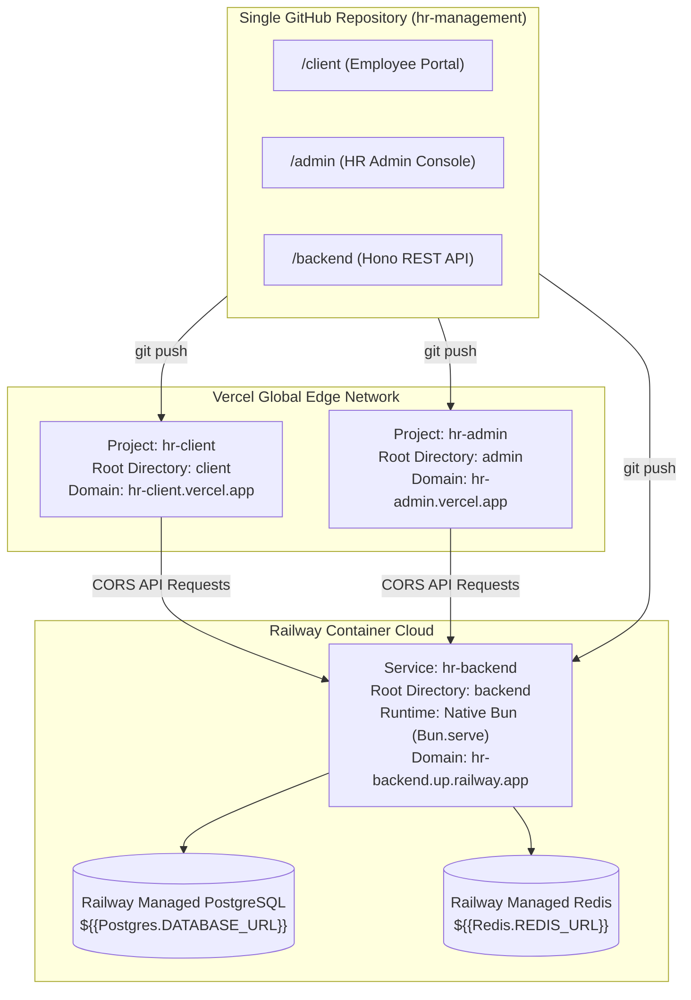

# Corporate Monorepo Production & Deployment Guide

This guide details the corporate standard deployment architecture for the `hr-management` monorepo:
- **Backend API & Data Tier**: Deployed on **Railway** (High-throughput Bun runtime, persistent Redis sockets, managed PostgreSQL).
- **Frontend Applications**: Deployed on **Vercel** (`client` and `admin` static Vite SPAs with global Edge CDN caching and TanStack Router catch-all rewrites).

---

## 1. Monorepo Continuous Delivery Overview

In this monorepo, **a single GitHub repository powers multiple independent cloud services**:



When you run `git push origin main`, Railway and Vercel simultaneously pull your changes and rebuild only their respective project directories.

---

## 2. Part 1: Deploying Backend & Database on Railway

Railway is our official backend hosting standard because it natively executes **Bun**, maintains persistent TCP socket connections for **Redis** (`ioredis`), and provides direct connection pooling for **Prisma 7** with **0ms cold starts**.

### Step 1: Create a New Project on Railway
1. Log in to [railway.app](https://railway.app) and click **New Project**.
2. Select **Provision PostgreSQL** (Railway creates a managed PostgreSQL instance).
3. In the same project canvas, click **Create** > **Database** > **Add Redis** (Railway creates a managed Redis instance).

### Step 2: Deploy the Backend Service from GitHub
1. In the same project canvas, click **Create** > **GitHub Repo**.
2. Select your `hr-management` repository.
3. Once the service appears on the canvas, click on it and navigate to **Settings**:
   - **Service Name**: Rename to `backend` (or `hr-backend`).
   - **Root Directory**: Set to `/backend`.
   - Railway will automatically detect [`backend/railway.json`](file:///c:/Users/konoe/projects/personal-projects/hr-management/backend/railway.json):
     - **Build Command**: `bun install && bun run prisma:generate && bunx prisma migrate deploy`
     - **Start Command**: `bun run src/index.ts`
     - **Healthcheck Path**: `/health` (verifies DB and Redis connectivity before routing traffic).

### Step 3: Configure Environment Variables on Railway
In the **Variables** tab of the backend service, add:

```ini
NODE_ENV=production
PORT=3000
DATABASE_URL=${{Postgres.DATABASE_URL}}
REDIS_URL=${{Redis.REDIS_URL}}
JWT_SECRET=use-a-strong-random-64-character-hex-string
JWT_REFRESH_SECRET=use-a-different-strong-random-64-character-hex-string
JWT_EXPIRES_IN=15m
REFRESH_TOKEN_EXPIRES_IN=7d
CORS_ORIGINS=https://hr-client.vercel.app,https://hr-admin.vercel.app
```

> [!TIP]
> Using Railway's reference syntax `${{Postgres.DATABASE_URL}}` and `${{Redis.REDIS_URL}}` allows the backend to communicate over Railway's ultra-low latency private internal network with automatic credential synchronization.

### Step 4: Generate a Public Domain
1. In **Settings** > **Networking** > **Public Networking**, click **Generate Domain**.
2. Copy the resulting URL (e.g. `https://hr-backend-production.up.railway.app`).
3. Verify the deployment by visiting:
   ```bash
   curl https://hr-backend-production.up.railway.app/health
   # Expected response: {"success":true,"data":{"status":"healthy","services":{"database":"up","redis":"up"}}}
   ```

---

## 3. Part 2: Deploying Frontends on Vercel (`client` & `admin`)

Both `client` and `admin` run on Vercel's global CDN with TanStack Router file-based routing.

### SPA Catch-All Rewrites
To prevent `404 Not Found` when refreshing routes like `/dashboard` or `/login`, each project includes a pre-configured `vercel.json` file:
- [`client/vercel.json`](file:///c:/Users/konoe/projects/personal-projects/hr-management/client/vercel.json)
- [`admin/vercel.json`](file:///c:/Users/konoe/projects/personal-projects/hr-management/admin/vercel.json)

### Step 1: Deploy Employee Portal (`client`)
1. Go to [vercel.com/new](https://vercel.com/new) and select the `hr-management` repository.
2. In **Project Name**, enter: `hr-client`.
3. In **Root Directory**, click **Edit** and choose `client`.
4. In **Build and Output Settings**:
   - Framework Preset: **Vite**
   - Build Command: `bun run build` (or `npm run build`)
   - Output Directory: `dist`
5. In **Environment Variables**:
   - `VITE_API_URL` = `https://<your-railway-app>.up.railway.app/api/v1`
6. Click **Deploy**.
7. In **Settings** > **Git** > **Ignored Build Step**, select **Custom** and enter:
   ```bash
   git diff --quiet HEAD^ HEAD .
   ```
   *(Ensures `client` only rebuilds when files in `client/` change).*

### Step 2: Deploy HR Administration Console (`admin`)
1. In your Vercel Dashboard, click **Add New...** > **Project** and select the same `hr-management` repository.
2. In **Project Name**, enter: `hr-admin`.
3. In **Root Directory**, click **Edit** and choose `admin`.
4. In **Build and Output Settings**:
   - Framework Preset: **Vite**
   - Build Command: `bun run build` (or `npm run build`)
   - Output Directory: `dist`
5. In **Environment Variables**:
   - `VITE_API_URL` = `https://<your-railway-app>.up.railway.app/api/v1`
6. Click **Deploy**.
7. In **Settings** > **Git** > **Ignored Build Step**, enter:
   ```bash
   git diff --quiet HEAD^ HEAD .
   ```

---

## 4. Part 3: Synchronizing CORS

Once both Vercel projects are live:
1. Copy the Vercel production domains (e.g. `https://hr-client.vercel.app` and `https://hr-admin.vercel.app`).
2. Go to your **Railway** dashboard > **backend** service > **Variables**.
3. Update `CORS_ORIGINS`:
   ```ini
   CORS_ORIGINS=https://hr-client.vercel.app,https://hr-admin.vercel.app
   ```
4. Railway will automatically redeploy the backend in seconds with the updated CORS allowlist.

---

## 5. Daily Development & Deployment Workflow

You never need to deploy each project manually. Your normal developer workflow is:

```powershell
# 1. Edit code in backend, client, or admin
# 2. Test locally
bun run build:all

# 3. Commit and push once
git add .
git commit -m "feat: implement leave request workflow"
git push origin main
```

Upon push:
- **Railway** detects changes in `backend/` and redeploys the API.
- **Vercel** detects changes in `client/` and `admin/` and redeploys the frontends.
- If a commit only touches `client/`, Railway and Vercel's `hr-admin` project automatically skip their builds.

---

## 6. Production Verification Checklist

- [ ] **Health Endpoint**: `https://<railway-domain>/health` returns `status: "healthy"` with database and redis reporting `"up"`.
- [ ] **Route Reloads**: Visiting `https://hr-client.vercel.app/login` directly returns `200 OK` (no 404).
- [ ] **API Connectivity**: Network requests from `client` and `admin` to the Railway backend succeed without CORS errors.
- [ ] **Instant Revocation**: Calling logout stores the token JTI in Railway Redis and denies subsequent requests.
